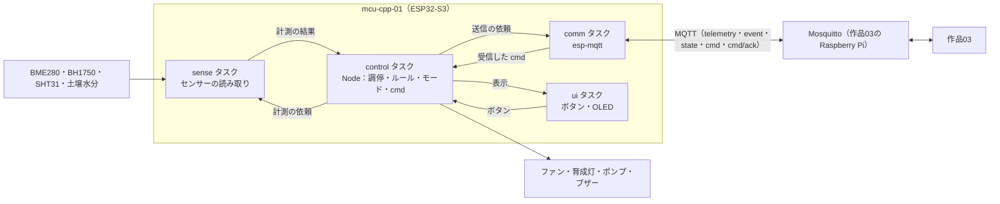

# iot-modular-node-esp32

[](https://github.com/io0323/iot-modular-node-esp32/actions/workflows/ci.yml)

種類の違う複数のセンサーとアクチュエーターを共通のインターフェースで扱う、ESP32-S3 向けのスマート制御ユニットのファームウェアです（C++20・ESP-IDF v5.5.6・FreeRTOS。作品02「モジュール型スマートデバイス制御システム」、device_id `mcu-cpp-01`）。上位（作品03）とは MQTT でやり取りします。

## 要点

- **何をするか**：温度・湿度・気圧・照度・土壌水分を周期で計測し、ファン・育成灯・ポンプ・ブザーを動かします。動かし方は次の4つです
  - ローカルルール（自動モード）
  - 本体のボタン（手動モード）
  - 作品03からの指令（リース付き）
  - 安全インターロック（どの経路より優先）

  出力を決めるのは `ControlArbiter` の1か所だけです。計測値・イベント・状態は、共通仕様（iot-common-spec v0.2.1）の電文で MQTT に送ります
- **主題：機器の追加は「新しいクラス＋構成表1行」**：センサーとアクチュエーターは `ISensor`・`IActuator` だけで扱い、app は具体的な機器を知りません
  - SHT31（温湿度）を実際に足した PR では、既存のファイルの変更が「追加1行×7」でした。内訳は、構成表の行と include、ビルド定義です
  - ただしそうなったのは P8 で構成表を「1行が1台」の表に直した後で、P3〜P7 の構成表では満たしていませんでした（[拡張性の実証](#拡張性の実証p8asht31-の追加)）
- **検証の範囲**：実機を使わずに確かめています
  - 単体テストとホスト結合テスト（236件）
  - 共通仕様の契約テスト（ホスト版と QEMU のファームウェア）
  - ブローカーの停止・再開の試験
  - 品質の検査（カバレッジ・clang-tidy・cppcheck・lizard・Doxygen・ThreadSanitizer）
  - QEMU と Wokwi でのターゲット版の実行

  **実機では確かめていません**（[実機フェーズで確かめること](#実機フェーズで確かめること)）



### 数値（P8 の完了時）

| 項目 | 値 |
|---|---|
| テスト | CTest 236件（host-debug・host-release・host-tsan とも合格）、契約テスト 9/9（ホスト版の既定・fakehw・TSan、QEMU のファームウェア） |
| カバレッジ（行） | domain 92.5%・app 96.1%（合格条件 80% 以上）、infra 96.2%・drivers 90.2% |
| 静的な検査 | clang-tidy 0・cppcheck 0・Doxygen の警告 0・循環的複雑度の最大 10 |
| ターゲット版の RAM | 静的な DIRAM 231,479／341,760 バイト（67.7%。P6 は 88.8%） |
| ヒープの最低残量 | Wi-Fi に接続した後 144,432 バイト（Wokwi）。QEMU で30分、5分後から下がらない（210,592 バイト） |
| 再接続 | ブローカーが戻ってから MQTT の再接続まで 10.2〜10.6 秒（broker_restart.py。要件は60秒以内） |
| スタックの残り | 最小で ui 41%（QEMU・Wokwi。基準 25% 以上） |

### 書類

| 書類 | 中身 |
|---|---|
| [要件定義・基本設計書](docs/design/01-requirements-basic-design.md) | 要件（FR・NFR）と基本設計（Claude Docs からの写し） |
| [詳細設計書](docs/design/02-detailed-design.md) | 層・クラス・処理の流れ・状態遷移・タスク・容量・構成表・異常系・基本設計書との差 |
| [テスト仕様書](docs/test-spec.md) | 要件ごとのテストと結果、受け入れ基準（MVP）の結論 |
| [ADR](docs/adr/README.md) | 設計の決定の記録（0001〜0006） |
| [品質ゲート](docs/quality.md) | 検査の一覧・抑止・エミュレーター・RAM・いまの数値 |
| [未決の論点](docs/open-questions.md) | 判断した論点と決定（P8 の完了時に「未決」「仮実装」は0件） |
| [Claude Code のプロンプト](docs/prompts/README.md) | フェーズ P1〜P8 の一覧とプロンプト |

## 対応する共通仕様

[iot-common-spec](https://github.com/io0323/iot-common-spec) **v0.2.1**（`external/iot-common-spec` に submodule で固定）。
P1 の時点で v0.2.2 のタグはまだないため v0.2.1 に固定しています（[docs/open-questions.md](docs/open-questions.md) #12）。
作品02は v0.2.1 で完成としています（#12。申し送り）。v0.2.2 のタグができたら、次の手順で上げます。

1. `git -C external/iot-common-spec fetch --tags && git -C external/iot-common-spec checkout v0.2.2` で submodule を上げ、`git add external/iot-common-spec` でコミットする
2. 契約テストキットの版を上げる：`.github/workflows/ci.yml` の `iotspec @ git+https://github.com/io0323/iot-common-spec@v0.2.1`（2か所）と `tools/qemu.sh` の同じ指定を `@v0.2.2` にする。手元は `uv tool install --force "iotspec @ git+https://github.com/io0323/iot-common-spec@v0.2.2"`
3. v0.2.2 の変更点（`docs/spec.md` の改訂履歴・`schemas/`・`profiles/mcu-cpp-01.yaml`）を読み、作品02に要る変更を `docs/open-questions.md` に書き出す
4. `tests/unit/spec_samples_test.cpp`（samples の受け付け・破棄）、契約テスト（既定・fakehw・QEMU）、broker_restart.py を流す
5. README の「対応する共通仕様」と「依存」の版を直す

## 依存（すべて版を固定）

| 依存 | 版 | 取り込み方 | 用途 |
|---|---|---|---|
| iot-common-spec | v0.2.1（e6280d0） | git submodule | Schema・サンプル・プロファイル・Mosquitto の設定・契約テストキット |
| Eclipse Paho MQTT C | v1.3.16 | FetchContent | ホスト版の MQTT クライアント（MQTTAsync、TLS なし、静的ライブラリ） |
| ESP-IDF | v5.5.6（esp-mqtt 0e9ec171） | Docker イメージ `espressif/idf:v5.5.6` | ターゲット版（ESP32-S3）のビルド |
| jsmn | 25647e692c7906b96ffd2b05ca54c097948e879c | FetchContent | cmd の JSON の字句解析（ヒープを使わない） |
| GoogleTest（gMock を含む） | v1.18.0 | FetchContent | 単体テスト・ホスト結合テスト |

## ビルドとテスト

必要なもの：CMake 3.25 以上、Ninja、C++20 のコンパイラ（Apple clang 21・GCC 13 で確認）、Docker（契約テストの Mosquitto）、uv（契約テストキット）。

```sh
git submodule update --init --recursive
cmake --preset host-debug && cmake --build --preset host-debug   # ASan・UBSan 付き、出力は build/host
ctest --preset host-debug --output-on-failure
```

## 契約テスト

```sh
# Mosquitto（ACL・パスワード付き。passwd は submodule の中にできるがコミットしない）
external/iot-common-spec/deploy/mosquitto/gen_passwd.sh
docker compose -f external/iot-common-spec/docker-compose.yml up -d mosquitto

uv tool install "iotspec @ git+https://github.com/io0323/iot-common-spec@v0.2.1"
IOTSPEC_MQTT_PASSWORD=iotspec-dev \
  iotspec-contract --role mcu-cpp-01 --target-cmd "./build/host/mcu_cpp_01 --log contract-log.jsonl" --junit contract.xml
```

### ブローカーの停止・再開の試験

Mosquitto を `docker compose stop`／`start` で20秒止めて戻し、再接続（60秒以内）・UPSTREAM_LOST → 停止中のイベント → UPSTREAM_RESTORED の順・
最後に強制終了したときの LWT を observer で確かめます（CI でも流しています）。

```sh
IOTSPEC_MQTT_PASSWORD=iotspec-dev uv run tests/system/broker_restart.py
```

## 品質ゲート

clang-tidy・cppcheck・lizard・Doxygen・カバレッジは、Docker のイメージ（`tools/docker/quality.Dockerfile`）の中で `tools/quality.sh` が動かします（Mac も CI も同じ）。
ほかに ThreadSanitizer（`host-tsan`）と最適化ビルド（`host-release`）のプリセットがあります。検査ごとの合格条件・抑止の一覧は [docs/quality.md](docs/quality.md) にあります。

```sh
tools/quality.sh all   # coverage・tidy・cppcheck・lizard・doxygen（出力は build/quality/）
```

| 検査 | いまの数値（P5） | 合格条件 |
|---|---|---|
| 行カバレッジ | domain 92.4%・app 95.9%（分岐 86.5%・86.0%） | 層ごとに 80% 以上 |
| clang-tidy・cppcheck | 指摘 0 件 | 0 件 |
| 循環的複雑度（lizard） | 最大 10（平均 2.4） | 10 以下 |
| Doxygen（公開 API） | 警告 0 件 | 0 件 |
| ThreadSanitizer | CTest・契約テスト・broker_restart.py で指摘 0 件（Paho の中だけの 2 件を抑止。open-questions #89・#93） | 0 件 |

## ターゲット版（ESP32-S3、ESP-IDF v5.5.6）

ESP-IDF は **v5.5.6** に固定し、Espressif の公式 Docker イメージ `espressif/idf:v5.5.6` でビルドします（Mac も CI も同じ。open-questions #94）。

```sh
cp firmware/sdkconfig.defaults.local.example firmware/sdkconfig.defaults.local   # Wi-Fi・MQTT の値を入れる（コミットしない）
docker run --rm -v "$PWD":/project -w /project/firmware espressif/idf:v5.5.6 \
  bash -c '. $IDF_PATH/export.sh >/dev/null && idf.py -B /project/build/firmware build size'
```

- 接続の情報は Kconfig の `NODE_WIFI_SSID`・`NODE_WIFI_PASSWORD`・`NODE_MQTT_URL`・`NODE_MQTT_PASSWORD`・`NODE_SITE`（既定は空）。`firmware/sdkconfig.defaults.local` があれば `sdkconfig.defaults` に重ねる（#102）
- SNTP の1つ目は MQTT のブローカーと同じホスト、2つ目は `pool.ntp.org`（`NODE_SNTP_SERVER1`・`2` で変えられる。#103）
- ピンの割り当て（仮、ESP32-S3-DevKitC-1）：I2C0 SDA GPIO8・SCL GPIO9、土壌水分 GPIO1（ADC1）、fan_main GPIO4・led_grow GPIO5・buzzer GPIO6（LEDC）、ポンプのリレー GPIO7、MODE ボタン GPIO10・ACTION ボタン GPIO11（`src/config/esp32_pins.hpp`。#105）
- イメージの大きさ（P8）：全体 1,012,573 バイト、DIRAM 67.7%（P6 は 88.8%。P7 で持ち方だけを変えて減らした。[docs/quality.md](docs/quality.md)）

| タスク | 優先度 | コア | 周期 | 呼ぶもの |
|---|---|---|---|---|
| control | 6 | 1 | 10ms | Node（app のクラスはここからだけ） |
| sense | 5 | 1 | 依頼を待つ | drivers::SensorIo（センサーの read・init・回復） |
| comm | 4 | 0 | 依頼を待つ（20ms） | esp-mqtt の API |
| ui | 3 | 1 | 20ms | drivers::UiIo（ボタン・OLED） |

## エミュレーター（QEMU・Wokwi）

ターゲット版のファームウェアを、実機の代わりにエミュレーターで動かします。手順・構成・確かめられないことの表・測った値は [docs/quality.md の「エミュレーター」](docs/quality.md) にあります。

```sh
tools/qemu.sh test        # QEMU：起動・4つのタスク・BOOT・stats（Docker の espressif/idf:v5.5.6）
tools/qemu.sh contract    # QEMU：ファームウェアに契約テスト（Mosquitto を先に起動しておく）
tools/qemu.sh soak 30     # QEMU：30分動かして、ヒープの最低残量が下がらないこと（NFR-03）
tools/wokwi.sh            # Wokwi：起動と計測値・ボタンとモード・Wi-Fi とヒープ・タスクウォッチドッグ
```

- **QEMU**（ESP-IDF v5.5.6 同梱の qemu-xtensa）：Wi-Fi・I2C・ADC・LEDC は再現されない。ネットワークは仮想の Ethernet（OpenCores Ethernet）で、ホストの Mosquitto につないで契約テストを流す。I2C と ADC の機器は、試験用の構成でフェイクに替える。タスクウォッチドッグは働かないので、Wokwi で確かめる
- **Wokwi**（wokwi-cli v0.29.1）：図は `wokwi/diagram.json`。BME280 と BH1750 は、データシートのレジスタだけを再現したカスタムチップ（`wokwi/chips/`）。Wi-Fi は Wokwi-GUEST。MQTT はつなげない（ローカルのブローカーにつなぐ Private Gateway は有料の機能。公開のブローカーは使わない）
- Wokwi のトークンは、環境変数 `WOKWI_CLI_TOKEN` か `~/.config/wokwi/token`（1行、`chmod 600`）。CI ではシークレット `WOKWI_CLI_TOKEN` を使い、なければジョブを「省略」として通す
- **Wokwi の無料枠**：CI はシミュレーションの時間で30日あたり50分、1回の実行は実際の経過時間で5分まで（docs.wokwi.com/wokwi-ci/getting-started）。4本で約133秒なので、30日におよそ22回流せる。そのため CI の Wokwi は、次のときだけ動かす：main への push で `firmware/`・`src/`・`wokwi/` が変わったとき、PR にラベル `wokwi` を付けたとき（マージの前に1回流す）、手動の実行（`gh workflow run wokwi.yml --ref <ブランチ>`）のとき

## 動かし方（ホスト版）

```sh
./build/host/mcu_cpp_01 [--broker host:port] [--site <site>] [--log <file.jsonl>] [--devices sim|fakehw]
```

`--devices` は機器の構成です。`sim`（既定）は P2 の模擬機器、`fakehw` は実機用のドライバをフェイクの I2C バス・ADC・PWM・GPIO・機器（BME280・BH1750・SSD1306）につないだ構成です。契約テストは両方の構成で流しています。

| 設定 | 既定 |
|---|---|
| ブローカー | `--broker`、なければ `IOTSPEC_MQTT_URL`（既定 `mqtt://localhost:1883`） |
| MQTT のユーザー名・client id | `mcu-cpp-01`（ACL が `%u` を使うため device_id と同じ） |
| パスワード | `IOTSPEC_MQTT_PASSWORD`（既定 `iotspec-dev`） |
| site | `--site`（既定 `home`） |
| BOOT の reset_reason | `MCU_CPP_01_RESET_REASON`（既定 `power_on`） |

SIGTERM・SIGINT では offline の state を送ってから切断します。強制終了ではブローカーが LWT（offline の state）を発行します。

### デバッグ入力（ホスト版だけ。省略すれば使わない）

| 引数 | 動き |
|---|---|
| `--sim <channel>=<value>[@<秒>]` | 起動から指定秒後に模擬センサーの値を変える（複数指定可） |
| `--sim-fault <センサーID>@<開始秒>[-<終了秒>]` | 模擬センサーを読めなくする（センサー ID は `bme280`・`bh1750`・`soil_moisture`。fakehw では I2C のタイムアウトか ADC の故障） |
| `--press-at <秒>` | ボタンの短押しを1回入れる（自動 → 手動 → 省電力 → 自動） |
| `--manual <id>=<level>@<秒>` | 手動の出力を入れる（手動モードでなければ無視してログに残す） |
| `--sntp-delay <秒>` | 起動から指定秒は時刻が同期していないことにする（その間は MQTT に接続しない。イベントは発生時刻で保持する） |
| `--net-down <開始秒>-<終了秒>` | その間ネットワークが使えないことにする（複数指定可。MQTT を自分で切るので LWT は出ない。open-questions #76） |

```sh
# 気温を5秒後に46℃、20秒後に42℃にする（ファンの高温インターロックが効いて、10秒後に解除される）
./build/host/mcu_cpp_01 --log run.jsonl --sim temp_air=46@5 --sim temp_air=42@20
# 5〜12秒はネットワークが使えない。その間の8秒に土壌水分センサーを故障させる（戻った後に LOST → SENSOR_FAULT → RESTORED）
./build/host/mcu_cpp_01 --log run.jsonl --net-down 5-12 --sim-fault soil_moisture@8
```

## 制御の調停

アクチュエーターごとに「安全インターロック ＞ 上位指令（リース中）＞ 本体の手動操作（手動モード）＞ ローカルルール（自動・省電力モード）＞ 既定値（0）」で出力を決めます（`src/app/control_arbiter.*`）。
インターロックとルールは構成表（`src/config/devices.*`）の1行ずつで、ControlArbiter は具体的なインターロックのクラスを知りません。

| インターロック（rule） | 対象 | 動き |
|---|---|---|
| `max_on_s` | pump | 連続30秒で停止。要求が0に戻り、かつ停止から60秒経つまで再開しない |
| `temp_high` | fan_main | temp_air が 45.0℃以上で1000に固定。43.0℃未満が10秒続いたら解除 |
| `sensor_fault` | fan_main | temp_air が fault・stale の間は1000に固定 |
| `sensor_fault` | pump | soil が fault・stale の間は上限0。その間の set_actuator は rejected（unsafe） |

| ルール | 入力 | 入る／出る | アクション |
|---|---|---|---|
| `light-on-dark`（照明系） | lux | 200 未満／250 以上 | led_grow 1000 |
| `cool-on-high-temp` | temp_air | 30.0℃以上／28.0℃未満 | fan_main 600 |
| `water-on-dry` | soil | 30.0% 未満 | pump 1000 を5秒（クールダウン10分） |

## 機器のドライバとデータシート

| ドライバ | 機器 | 出典（コメントに節・表・ページを書いている） |
|---|---|---|
| `Bme280` | Bosch BME280（温度・湿度・気圧、I2C） | BME280 Data sheet BST-BME280-DS001-24 rev 1.24（Feb 2024）。補正式の照合は BMP280 Data sheet BST-BMP280-DS001-26 rev 1.26（Oct 2021）3.12 節 |
| `Bh1750` | ROHM BH1750FVI（照度、I2C） | BH1750FVI Technical Note 2011.11 Rev.D |
| `Ssd1306` | Solomon Systech SSD1306（128×64 OLED、I2C） | SSD1306 Rev 1.1（Apr 2008）、SSD1306 Application Note Rev 0.4（Jan 2009） |
| `Sht31` | Sensirion SHT31（SHT3x-DIS。温度・相対湿度、I2C。P8a で追加） | Datasheet SHT3x-DIS December 2022 - Version 7 |
| `SoilMoisture` | 静電容量式の土壌水分センサー（ADC） | データシートなし。乾 3000＝0%・湿 1300＝100% の直線（**仮の校正値**。実機フェーズで校正） |
| `PwmActuator`・`RelayActuator`・`Button` | ファン・LED・ブザー（PWM）、ポンプ（リレー）、タクトスイッチ×2 | データシートなし。値の決まりは open-questions #41〜#47・#58 |

ボタンは2つです。MODE の短押しでモードを切り替えます（自動 → 手動 → 省電力 → 自動）。ACTION は手動モードでだけ働き、短押しで操作する機器を選び（fan_main → led_grow → pump → buzzer）、長押しでその機器を 0 と 1000 で切り替えます。

## 拡張性の実証（P8a：SHT31 の追加）

NFR-01 は「新しい機器の追加で変更するのは、新しいクラスのファイルと構成テーブル1行だけ。既存クラスは変更しない」です。温湿度センサー SHT31 を実際に足して確かめました。経緯を順に書きます（open-questions #139・#145・#146）。

1. **P3〜P7 の構成表では、NFR-01 を満たしていなかった。** 実機用の構成表 `config::HwRig` と fakehw 用の `config::FakeHwRig` は、表ではなくクラスでした。機器ごとに、メンバー変数・コンストラクタの初期化子・`std::array<domain::ISensor*, 3> sensors_` の一覧を書いていました。リファクタリングの前（P7 のマージ時点、a09ad65）の構成表に SHT31 を実際に足して数えると、次の変更が要りました（#145）。
   - 変える既存のファイル：hw.hpp・hw.cpp・fakehw.hpp・fakehw.cpp の4つ
   - 差分：追加16行・変更3行。変更は、`sensors_` の大きさ、`sensors_` の並び、FakeHwRig の初期化子
   - 変わる既存のクラス：HwRig と FakeHwRig の2つ
2. **P8 で SHT31 を足そうとして見つかった。** P8a に入る前の確かめで分かり、作業を止めて相談しました（#145）。
3. **PR #8 で、構成表を「1行が1台」の表に直した（振る舞いは変えていない）。**
   - 表：実機用は `src/config/hw_table.hpp`、fakehw 用は `src/config/fakehw_table.hpp`
   - クラスのメンバー・初期化・一覧・アクセサーは、表から X マクロで展開する
4. **その後の P8a では、既存のファイルの変更が「追加1行×7」になった。** 削除と変更は0行です。

### 変えてよいもの（#139）

- 新しいファイル：ドライバのクラス、そのテスト、フェイクの機器
- 構成表：表の1行と、そのクラスの include の1行（実機用・fakehw 用それぞれ）
- ビルド定義でソースを並べている箇所への1行：ホスト版の CMake、ESP-IDF のコンポーネント、テストの登録

README・open-questions などの書類の変更は数えていません（#146）。P8a でも、この README の節と open-questions を変えています。

### SHT31 の決まり（#140〜#143）

- **チャネル**：`temp_aux`（degC）と `humidity_aux`（pct_rh）。周期は 2000ms
- **接続**：I2C0 のアドレス 0x44
- **読み方**：単発計測・高い再現性・クロックストレッチなし。CRC-8 が合わなければ、その計測を失敗にする
- **ルール・インターロック**：使わない（計測と送信だけ）
- **入れた構成**：実機用の構成表と `--devices fakehw`。ホスト版の既定（模擬機器）には入れていない
- **共通仕様のプロファイル**：`profiles/mcu-cpp-01.yaml` には2チャネルがない。共通仕様の変更案として申し送りにした（#142）

### 差分（`git diff --numstat main...feature/add-sht31 -- src firmware tests`）

| 区分 | ファイル | 追加 | 削除 |
|---|---|---|---|
| 新しいファイル | `src/drivers/sht31.hpp`・`sht31.cpp`（ドライバ） | 92・63 | 0 |
| 新しいファイル | `src/drivers/fake/fake_sht31.hpp`（データシートの命令・応答・CRC を再現するフェイク） | 114 | 0 |
| 新しいファイル | `tests/unit/sht31_test.cpp`・`tests/integration/node_sht31_test.cpp` | 129・136 | 0 |
| 構成表 | `src/config/hw_table.hpp`（実機用の表の行） | 1 | 0 |
| 構成表 | `src/config/hw.hpp`（ドライバのヘッダの include） | 1 | 0 |
| 構成表 | `src/config/fakehw_table.hpp`（fakehw 用の表の行） | 1 | 0 |
| 構成表 | `src/config/fakehw.hpp`（フェイクのヘッダの include） | 1 | 0 |
| ビルド定義 | `src/CMakeLists.txt`（ホスト版のソースの一覧） | 1 | 0 |
| ビルド定義 | `firmware/components/node_core/CMakeLists.txt`（ESP-IDF のコンポーネント） | 1 | 0 |
| ビルド定義 | `tests/CMakeLists.txt`（テストの登録） | 1 | 0 |

構成表に足した行は、次のとおりです。

```cpp
// src/config/hw_table.hpp
NODE_SENSOR(drivers::Sht31, sht31, (i2c(hw, drivers::Sht31::kAddrA), hw.timer), 2000, ({"temp_aux", domain::Unit::DegC, 2000}, {"humidity_aux", domain::Unit::PctRh, 2000}))
// src/config/fakehw_table.hpp
NODE_FAKE_I2C_ARGS(drivers::fake::FakeSht31Device, sht31_device, (timer), drivers::Sht31::kAddrA)
```

**既存のクラスへの変更が0であることの確かめ方**

```sh
git diff --numstat main...feature/add-sht31 -- src firmware tests   # 既存のファイルはどれも「追加1・削除0」
git diff --diff-filter=M --name-only main...feature/add-sht31 -- src firmware tests
# → src/config の4つ（表2つと include 2つ）と CMakeLists.txt の3つだけ
```

## 構成

```
src/
  support/        Result・Error・固定容量コンテナ（自作 Error Framework の仮の代わり）
  hal/            ハードのインターフェースだけ（I2C・ADC・PWM・GPIO・ミューテックス・タイマー。自作 iot-hal に置き換える前提）
  domain/         値・機器の契約（ISensor・IActuator・IInterlock・IButton・IDisplay）・リース・重複排除・インターロック3種・ルール・計測値と品質
  app/            ControlArbiter・ModeManager・ManualControl・RuleEngine・SensorPoller・UiService・CommandService・Telemetry・State・Event・
                  ConnectionManager・Publisher・Node
  infra/          IMqttLink・INetwork・ITimeSync・IClock・IRandom・JsonWriter・CmdParser・エンベロープ・トピック・送信量の制限
  drivers/        機器のドライバ（データシートどおり）
  drivers/fake/   hal と機器のフェイク（テストと --devices fakehw）
  drivers/sim/    ホスト用の模擬センサー・模擬アクチュエーター
  config/         構成表（devices.cpp：模擬機器、hw_table.hpp：実機用の1行が1台の表（HwRig が展開）、fakehw_table.hpp：フェイクの機器の表）
  platform/host/  Paho・時計・時刻の同期・ネットワーク（模擬）・乱数・JSON Lines のログ・デバッグ入力・main（POSIX・Paho を使えるのはここだけ）
  platform/esp32/ ESP-IDF の hal・infra の実装、タスク、app_main（ESP-IDF・FreeRTOS を使えるのはここだけ）
firmware/         ESP-IDF のプロジェクト（src/ をコンポーネント node_core・node_platform_esp32 として読む）
tests/unit/  tests/integration/  tests/system/（broker_restart.py）
tools/          品質のイメージ（docker/quality.Dockerfile）・quality.sh・TSan の抑止（tsan.supp）
```

## 実機フェーズで確かめること

開発段階では実機を使っていません。次のことは、実機フェーズで確かめます（[テスト仕様書](docs/test-spec.md)）。

- ドライバと実際の機器の差：BME280・BH1750・SHT31・SSD1306。土壌水分の校正値（仮の 3000／1300。#43）、I2C のプルアップ（#113）
- PWM（LEDC）の波形・リレー・ブザーの実際の動き。ピンの割り当て（仮。#105）
- OLED の表示の向き（データシートのリセット値のまま。Wokwi では180度回る。#56・#134）
- NFR-02 の実測（cmd を受けてから出力まで 100ms、ack まで 200ms）
- NFR-03 の24時間（ヒープの最低残量が下がり続けない）と、Wi-Fi と MQTT が同時に動いた状態のヒープ
- NFR-08 の Wi-Fi の AP の停止と復旧（60秒以内の再接続）
- スタックの残りの見直し。I2C のバスの回復、Wi-Fi・MQTT の再接続の直後の一括の送信を通した後の値（#137）
- power_on と watchdog 以外のリセット要因（brownout など）の実際の発生
- ポンプが動き続ける最長（30秒＋タスクウォッチドッグの5秒。ADR 0005）
- 省電力モードのライトスリープと消費電流（入れていない。#107）。FR-12（NVS への保存）は本版では扱わない（#108・#144）

## この後の作業（申し送り）

- **共通仕様**：v0.2.2 のタグができたら上げる（上の「対応する共通仕様」の手順。#12）。次の2つは、共通仕様の変更案として io に渡す
  - ESP_RST_PANIC の扱い（#7）
  - プロファイルへの SHT31 の2チャネルの追加（#142）
- **作品03**：SNTP の1つ目のサーバーを MQTT のブローカーと同じホストにしている（#11・#111）
- **CI**：NFR-03 の「自分のコードがヒープを確保しない」の grep は、PR ごとに手で流している。CI の手順に足すとよい（テスト仕様書の受け入れ基準の3つ目）
- **模擬機器の構成表**：`config/devices.cpp` の `SimRig` は表にしていない（#147）。模擬機器を足すことがあれば、実機用と同じ表にする

## フェーズ

| フェーズ | 内容 | 状態 |
|---|---|---|
| P1 | ホスト版の骨組み、MQTT 接続、cmd の受け付け、CI での契約テスト | 完了（PR #1） |
| P2 | ControlArbiter の5段の優先度、ModeManager、RuleEngine、インターロックの残り | 完了（PR #2） |
| P3 | 機器ドライバと I2C フェイク、ボタンと表示 | 完了（PR #3） |
| P4 | SNTP 同期後の接続、イベント保持、指数バックオフ、送信量の制限、ブローカー停止・復旧 | 完了（PR #4） |
| P5 | 品質ゲート（カバレッジ・clang-tidy・cppcheck・lizard・Doxygen・ThreadSanitizer） | 完了（PR #5） |
| P6 | ESP-IDF ターゲット版 | 完了（PR #6） |
| P7 | RAM の見直しとエミュレーター（QEMU・Wokwi） | 完了（PR #7） |
| P8 | 構成表のリファクタリング、拡張性の実証（SHT31）、書類の仕上げ | 完了（PR #8・#9・P8b の PR） |

フェーズごとの目的と結果は [docs/prompts/README.md](docs/prompts/README.md) にあります。
