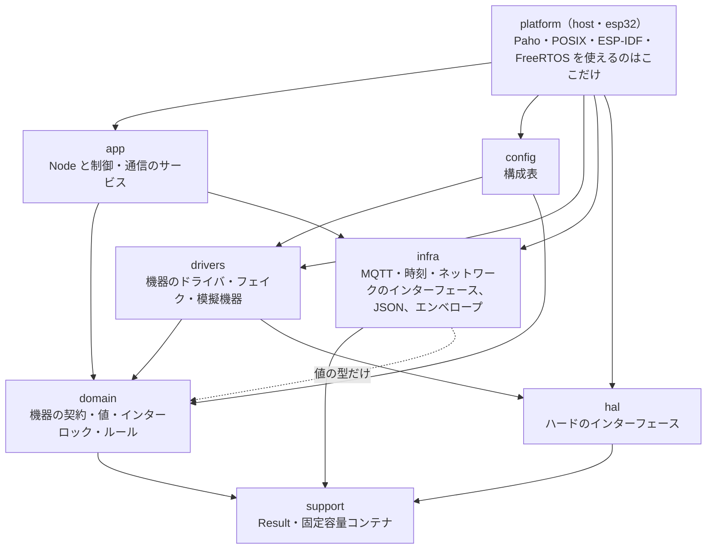
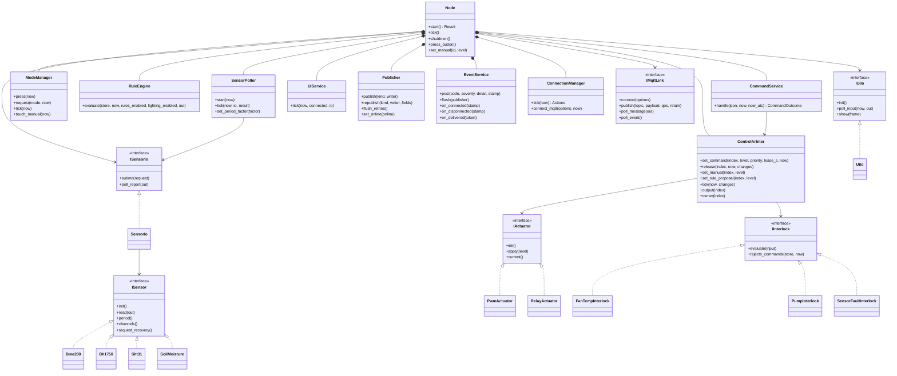
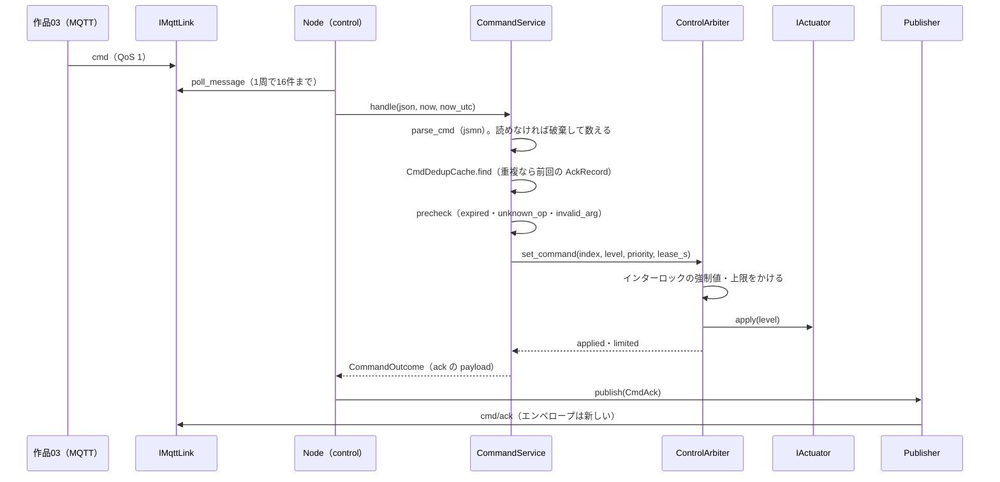
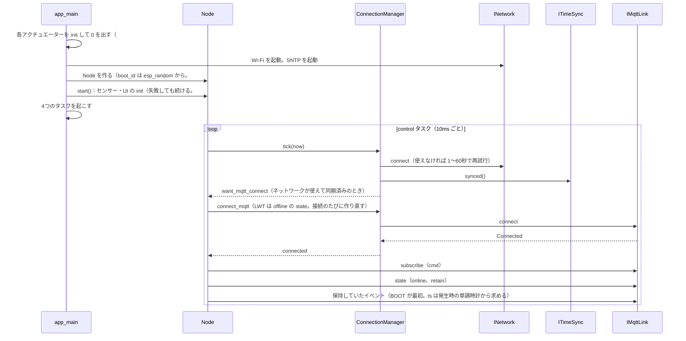
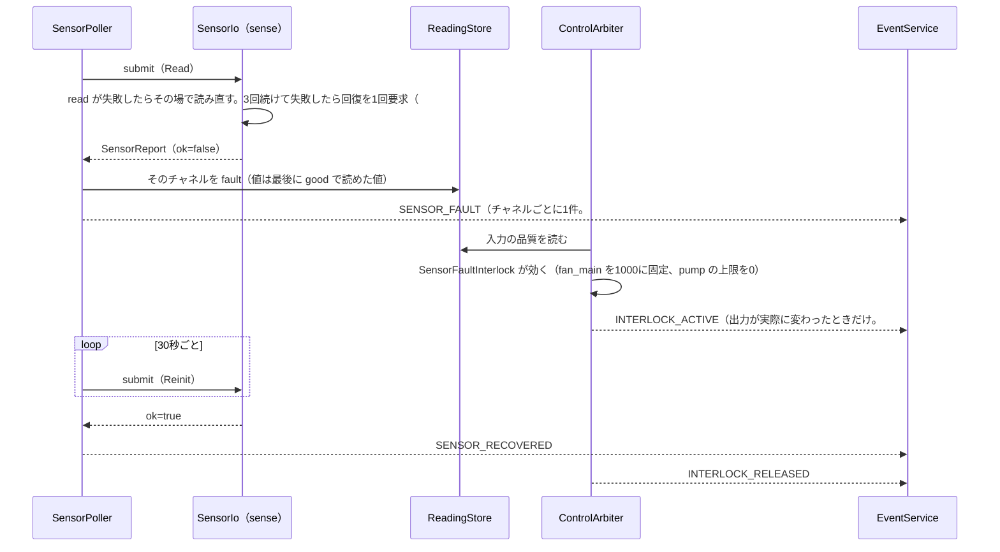
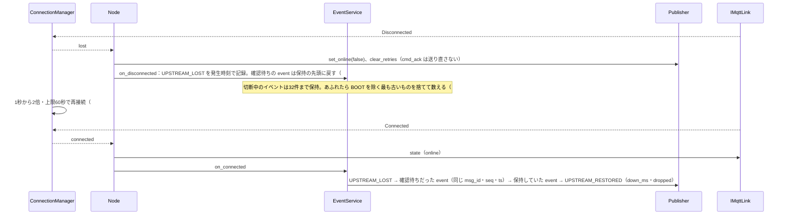
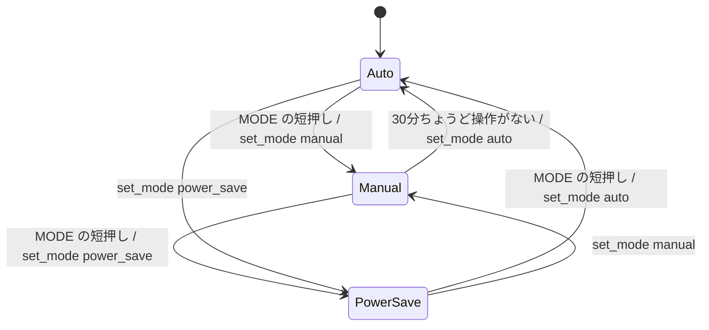
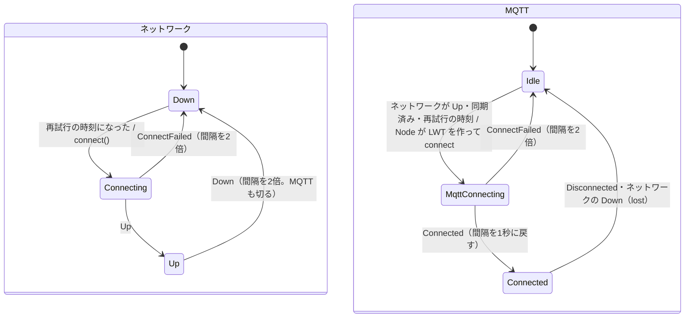
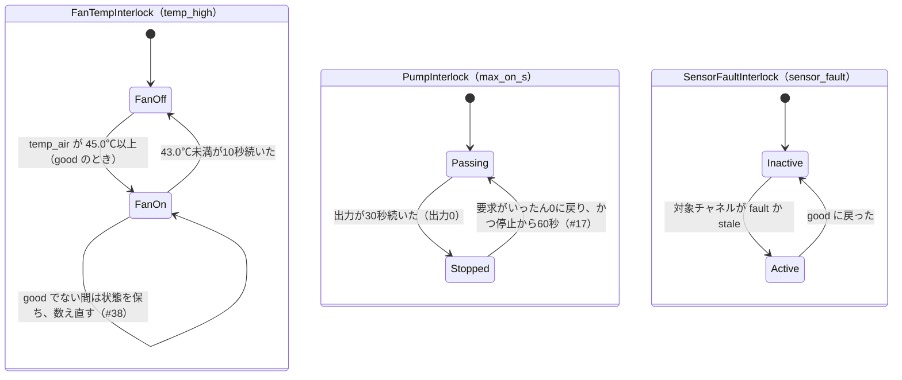

# 作品02 詳細設計書（mcu-cpp-01）

この詳細設計書は、P8 の完了時点（main の c60702b 以降）のコードから書いています。

- クラス名・関数名・容量・値は、`src/` と一致させています。食い違いを見つけたら、コードを正とし、この書類を直します
- 要件と基本設計は [01-requirements-basic-design.md](01-requirements-basic-design.md) です。基本設計書と違う箇所は、最後の「基本設計書との差」にまとめました
- 決定の理由は [docs/open-questions.md](../open-questions.md)（番号を `#n` で書きます）と [docs/adr/](../adr/README.md) にあります

## 1. 層と依存の向き



| 層 | ディレクトリ | 中身 | 決まり |
|---|---|---|---|
| support | `src/support/` | `Result<T>`・`Error`・`StaticVector`・`FixedString` | 自作 Error Framework の代わり（ADR 0001） |
| hal | `src/hal/` | `II2cBus`・`IAdc`・`IPwm`・`IGpio`・`IMutex`・`ITimer`・`I2cTransaction`・`I2cDevice` | インターフェースだけ。自作 iot-hal の代わり（#54・ADR 0001） |
| domain | `src/domain/` | `ISensor`・`IActuator`・`DeviceRegistry`・`IInterlock` と3つの実装・`Lease`・`CmdDedupCache`・`ReadingStore`・`Rule`・`ISensorIo`・`IUiIo`・`IButton`・`IDisplay` | ヒープを使わない |
| infra | `src/infra/` | `IMqttLink`・`INetwork`・`ITimeSync`・`IClock`・`IRandom`・`ILogSink`、`JsonWriter`・`CmdParser`（jsmn）・`EnvelopeFactory`・`Topics`・`RateLimiter`・`ulid`・`reset_cause` | ヒープを使わない。domain は `domain/types.hpp` の値の型（`Priority` など）だけを使う（#148） |
| drivers | `src/drivers/` | `Bme280`・`Bh1750`・`Sht31`・`SoilMoisture`・`PwmActuator`・`RelayActuator`・`Ssd1306`・`Button`、`SensorIo`・`UiIo`（#110）。`drivers/fake/`：hal と機器のフェイク、`drivers/sim/`：模擬機器 | `src/platform/` を include しない（fake を除く） |
| app | `src/app/` | `Node` と、`ControlArbiter`・`ModeManager`・`ManualControl`・`RuleEngine`・`SensorPoller`・`UiService`・`CommandService`・`Publisher`・`EventService`・`StateService`・`TelemetryService`・`ConnectionManager` | Node と app のクラスは、ターゲット版では control タスクからだけ呼ぶ（#96） |
| config | `src/config/` | 構成表：`hw_table.hpp`・`hw.*`（実機用 `HwRig`）、`fakehw_table.hpp`・`fakehw.*`（`FakeHwRig`）、`devices.*`（模擬機器 `SimRig`・インターロックとルールの値）、`esp32_pins.hpp` | 表の書き方は 7 章 |
| platform | `src/platform/host/`・`src/platform/esp32/` | hal・infra の実装、main・app_main、ターゲット版のタスク | ESP-IDF・Paho・POSIX を使えるのはここだけ |

ターゲット版は `firmware/` の ESP-IDF のプロジェクトで、`src/` をコンポーネントとして読みます（ソースは写していません。#94）。

- `node_core`：support・hal・domain・infra・app・drivers（fake と sim を除く）・config の実機用の表
- `node_platform_esp32`：`src/platform/esp32/`

試験用の構成（`NODE_TEST_FAKE_HW`）のときだけ、`node_core` にフェイクの機器が入ります（#132）。

## 2. 主なクラスの責務



| クラス | 責務 |
|---|---|
| `app::Node` | アプリ全体。tick の中で、接続 → 計測 → モード → UI → cmd → ルール → 調停 → telemetry → イベント・送り直しの順に呼ぶ（8 章のシーケンス） |
| `app::ControlArbiter` | 出力を決める唯一の場所。アクチュエーターごとに「インターロック ＞ 上位指令（リース中）＞ 本体の手動操作（手動モード）＞ ローカルルール（自動・省電力）＞ 既定値 0」。インターロックの強制値と上限は、どの段の結果にもかける。具体的なインターロックのクラスや機器 ID は知らない（#19・#20） |
| `app::CommandService` | cmd の解析（`infra::parse_cmd`）、重複排除（`CmdDedupCache`）、検査（expired・unknown_op・unknown_target・invalid_arg・unsafe）、ControlArbiter・ModeManager への適用、ack の payload の作成 |
| `app::ModeManager` | 自動・手動・省電力（State パターン：`AutoState`・`ManualState`・`PowerSaveState`）と、手動の30分のタイムアウト |
| `app::ManualControl` | 本体の手動操作（ACTION ボタン）で、選んだ機器の 0／1000 を切り替える。手動モードのときだけ |
| `app::RuleEngine` | ローカルルールの評価（ヒステリシス・パルス・クールダウン）。提案を出すだけで、機器は動かさない |
| `app::SensorPoller` | 周期の来たセンサーへの依頼と、結果からの品質の判定・故障と復帰・30秒ごとの再初期化（#48・#55） |
| `app::UiService` | ボタンの判定の扱いと、OLED の8行の中身を作る。省電力モードでは消灯 |
| `app::Publisher` | エンベロープを付けて送る。kind ごとの送信量の上限と、cmd_ack・state の送り直し待ち（8件・1件 1KB） |
| `app::EventService` | イベントの保持（32件）、確認待ちの管理、切断の後の送り直し（同じ msg_id・seq・ts）、UPSTREAM_LOST／RESTORED |
| `app::StateService`・`TelemetryService` | state と telemetry の payload を作る |
| `app::ConnectionManager` | 「ネットワーク → SNTP の同期 → MQTT」の順の接続と、1〜60秒の再接続（#64・#69） |
| `drivers::SensorIo`・`UiIo` | センサーの read・init・回復と、ボタン・OLED の、ハードに触る部分（#110）。ターゲット版では sense・ui のタスクで動く |

## 3. 処理の流れ

### 3.1 cmd → 調停 → 出力 → ack



cmd を受けた tick の中で、出力と ack の送信が終わります（NFR-02。`NodeTest.Nfr02_OutputAndAckFinishWithinTheTickThatReceivedCmd`）。重複した cmd_id には、`AckRecord` から作り直した前回と同じ payload を、新しいエンベロープで返します（#28・ADR 0004）。

### 3.2 起動 → 同期 → 接続 → state・BOOT



### 3.3 センサーの故障 → インターロック → イベント



### 3.4 切断 → 保持 → 再接続 → LOST・RESTORED



## 4. 状態遷移

### 4.1 ModeManager



| モード | ルール | lighting のルール | 手動操作 | 計測周期 | タイムアウト |
|---|---|---|---|---|---|
| Auto | 有効 | 有効 | 無効 | 1倍 | なし |
| Manual | 無効 | 無効 | 有効 | 1倍 | 30分（入った時刻か最後の手動操作から） |
| PowerSave | 有効 | 無効 | 無効 | 5倍 | なし |

- モードが変わると、MODE_CHANGED（`{"from","to","cause"}`。#33）を1件送り、state を出し直す
- 同じモードへの set_mode では、何もしない（#18）
- 表示は、PowerSave で消灯（UiService）

### 4.2 ConnectionManager



再接続の間隔は `Backoff`（1秒から2倍、上限60秒、ジッターなし）です。ネットワークと MQTT で別々に持ちます。

### 4.3 インターロック



| インターロック | 対象 | 値（`config/devices.hpp`。ビルド時に固定。#2） |
|---|---|---|
| `FanTempInterlock` | fan_main | temp_air 45.0℃以上で1000に固定、43.0℃未満が10秒で解除（#21） |
| `SensorFaultInterlock`（Force） | fan_main | temp_air が good でない間は1000に固定（#22） |
| `PumpInterlock` | pump | 30秒で0。要求が0に戻り、かつ60秒で解除（#17） |
| `SensorFaultInterlock`（Upper、rejects_commands） | pump | soil が good でない間は上限0。その間の set_actuator は rejected（unsafe）（#23） |

INTERLOCK_ACTIVE／RELEASED は、出力が実際に変わったときに1件ずつ出します。detail は `{"id","rule"}` です（#16・#24・#37）。

## 5. タスク（ターゲット版）

| タスク | 優先度 | コア | 周期 | スタック | 呼ぶもの |
|---|---|---|---|---|---|
| control | 6 | 1 | 10ms | 8KB | `Node::tick`（app のクラスはここからだけ）、1分ごとの stats のログ |
| sense | 5 | 1 | 依頼を待つ（100ms で起きる） | 4KB | `drivers::SensorIo`（センサーの read・init・回復） |
| comm | 4 | 0 | 依頼を待つ（20ms） | 6KB | `EspMqttComm`（esp-mqtt の connect・publish・subscribe・stop） |
| ui | 3 | 1 | 20ms | 4KB | `drivers::UiIo`（ボタンの poll・OLED への書き込み） |

- 4つのタスクは、すべてタスクウォッチドッグ（5秒）に登録します。切れたらパニックで再起動します（#98）
- スタックの残りの最小は、QEMU と Wokwi で測りました。control 46%・sense 47%・comm 72%・ui 41% で、どれも 25% 以上です（#137。docs/quality.md）
- タスクのスタックは、静的に確保します（`xTaskCreateStaticPinnedToCore`）

| キュー・リングバッファ | 向き | 容量 |
|---|---|---|
| sensor_requests | control → sense | `SensorRequest` 8件 |
| sensor_reports | sense → control | `SensorReport` 8件 |
| ui_inputs | ui → control | `UiInput` 8件 |
| display_frames | control → ui | `DisplayFrame` 1件（最新で上書き） |
| commands（リングバッファ） | control → comm | 16KB（接続・切断・購読・発行の依頼。可変長） |
| inbound（リングバッファ） | esp-mqtt → control | 8KB（受信した電文） |
| link_events | comm → control | 16件 |
| deliveries | comm → control | 32件（PUBACK） |
| mqtt_events | esp-mqtt → comm | 32件 |

タスクの間に共有変数はなく、受け渡しはキューとリングバッファだけです。I2C のミューテックスは、sense と ui が hal で分け合います（`I2cTransaction`。#49）。

## 6. 容量と RAM

固定の容量（どれも静的に確保し、初期化の後にヒープを使いません。NFR-03）：

| 対象 | 容量 | 場所 |
|---|---|---|
| イベントの保持 | 32件（detail は 192 バイトまで） | `EventService::kCapacity`・`kDetailMax`（#8） |
| QoS 1 の確認待ち | 32件 | `IMqttLink::kMaxInflight` |
| 送り直し待ち（cmd_ack・state） | 8件、1件 1,024 バイト | `Publisher::kRetryCapacity`・`kRetryMessageMax`（#15・#116） |
| 電文 | 2,048 バイト（トピック 128） | `Publisher::kMessageMax`・`IMqttLink::kPayloadMax`・`kTopicMax` |
| 重複排除 | 64件・10分 | `CmdDedupCache::kCapacity`・`kRetentionMs` |
| 送信量 | kind ごとに平均毎秒10件・瞬間50件 | `RateLimiter::kRatePerS`・`kBurst` |
| リース | 省略時60秒・上限600秒 | `Lease::kDefaultS`・`kMaxS` |
| センサー・チャネル | 8台・16チャネル（1台は4チャネルまで） | `SensorPoller::kMaxSensors`・`ReadingStore::kMaxChannels`・`SensorReport::kMaxReadings` |
| アクチュエーター | 8台、1台にインターロック4つ | `ControlArbiter::kMaxActuators`・`kMaxInterlocksPerActuator` |
| ルール | 16 | `RuleEngine::kMaxRules` |
| 1周で読む cmd | 16件 | `Node::kMaxInboundPerTick` |

ターゲット版の RAM（`idf.py size`、製品の構成）：

| | P6 | P7（見直し後） | P8（SHT31 の後） |
|---|---|---|---|
| DIRAM | 303,535 バイト（88.8%） | 231,439 バイト（67.7%） | 231,479 バイト（67.7%） |
| Node | 124.5KB | 52.4KB | — |

P7 で、イベント・確認待ち・重複排除を「電文を作り直す値」で持つようにしました（ADR 0004）。ヒープの最低残量は、Wi-Fi に接続した後で 144,432 バイトです（Wokwi）。

## 7. 構成表の見方と機器を追加する手順

構成表は「1行が1台」です（PR #8・ADR 0006）。

```cpp
// src/config/hw_table.hpp（実機用。HwRig が展開する）
// NODE_SENSOR(ドライバの型, 名前, (ドライバの前半の引数), 周期[ms], (チャネル {ID, 単位, 周期[ms]}, ...))
NODE_SENSOR(drivers::Sht31, sht31, (i2c(hw, drivers::Sht31::kAddrA), hw.timer), 2000, ({"temp_aux", domain::Unit::DegC, 2000}, {"humidity_aux", domain::Unit::PctRh, 2000}))
// NODE_ACTUATOR(ドライバの型, 名前, (ドライバの前半の引数), (仕様 {ID, 下限, 上限, 連続の上限[s]}), インターロックの一覧)
NODE_ACTUATOR(drivers::RelayActuator, pump, (hw.gpio, kGpioPumpRelay, kPumpRelayActiveHigh), ("pump", 0, 1000, std::uint16_t{kPumpMaxOnS}), pump_interlocks_)

// src/config/fakehw_table.hpp（--devices fakehw と QEMU の試験用。FakeHwRig が展開する）
// NODE_FAKE_I2C(フェイクの型, 名前, アドレス) / NODE_FAKE_I2C_ARGS(フェイクの型, 名前, (引数), アドレス)
NODE_FAKE_I2C_ARGS(drivers::fake::FakeSht31Device, sht31_device, (timer), drivers::Sht31::kAddrA)
```

- 行の順が、telemetry の `readings[]`・state の `channels[]`・`actuators[]` の順になる
- HwRig・FakeHwRig は、表から次を展開する
  - メンバー、チャネルと仕様の静的な値
  - 初期化子、`sensors_`・`actuators_` の一覧と大きさ
  - アクセサー、バスへの登録
- インターロックの値とローカルルールは `config/devices.hpp`。インターロックの組み合わせは HwRig のメンバー（`fan_interlocks_`・`pump_interlocks_`）

**機器を追加する手順**（P8a の SHT31 を例に）：

1. `src/drivers/` に `ISensor`（または `IActuator`）を実装したクラスを足す（例：`sht31.hpp`・`sht31.cpp`。データシートの節・表の番号をコメントに書く）
2. データシートのコマンドと応答を再現するフェイクを `src/drivers/fake/` に足す（例：`fake_sht31.hpp`）
3. 単体テストとホスト結合テストを `tests/` に足す（例：`unit/sht31_test.cpp`・`integration/node_sht31_test.cpp`）
4. 構成表に1行ずつ足す：`hw_table.hpp` の行と `hw.hpp` の include、`fakehw_table.hpp` の行と `fakehw.hpp` の include
5. ビルド定義に1行ずつ足す：`src/CMakeLists.txt`、`firmware/components/node_core/CMakeLists.txt`、`tests/CMakeLists.txt`

P8a では、既存のファイルの変更がこの「追加1行×7」だけでした（#139・#145・#146）。

- 模擬機器の構成（`config/devices.cpp` の `SimRig`。ホスト版の既定）は試験用で、表にしていない（#147）
- 新しい機器を state で知らせても、共通仕様のプロファイル（`profiles/mcu-cpp-01.yaml`）は変わらない（SHT31 の2チャネルは申し送り。#142）

## 8. 異常系

基本設計書 第7章の表を、実装した動きで書き直したものです。

| 異常 | 検知 | 対応（実装） | 決定 |
|---|---|---|---|
| I2C のセンサーの無応答 | 1回の通信のタイムアウト 50ms、BME280 のチップ ID の不一致、SHT31 の CRC の不一致 | その場で読み直し、3回続けて失敗したら、バスの回復を1回だけ要求する。チャネルを fault にし（値は最後に good で読めた値）、SENSOR_FAULT をチャネルごとに1件送る。30秒ごとに再初期化し、読めたら SENSOR_RECOVERED を送る。そのチャネルを入力にするルールは提案を出さない（パルスも止める） | #6・#30・#48・#52・#55 |
| I2C のバスのハング | 連続の失敗（上と同じ3回） | バスの回復：ターゲット版は、i2c_master のドライバを外し、SCL を GPIO として15回クロックを出してから、ドライバを作り直す | #106 |
| I2C のバスの取り合い | ミューテックスの取得のタイムアウト 100ms | その計測を失敗として扱う | #49 |
| 計測値の古さ | 最後に good で読めた時刻から周期の3倍（省電力モードでは周期も5倍） | 本体の中で stale にし、ルールとインターロックの入力に使わない（telemetry の quality には出さない） | #25・#39・#52 |
| センサー・UI の初期化の失敗 | init の失敗 | 起動を止めず、diag のログに出す。センサーは最初の計測で fault になる | #130 |
| アクチュエーターの初期化の失敗 | init の失敗 | 起動を止める（出力を0にできないため） | #130 |
| Wi-Fi・MQTT の切断 | イベント（ネットワークの Down、MQTT の Disconnected） | 1秒から2倍・上限60秒で再接続（ネットワークと MQTT で別々）。ネットワークが落ちたら MQTT も切断として扱う。上位のリースは期限で切れ、ローカル制御は続く | #64・#69・#76 |
| SNTP の未同期 | `ITimeSync::synced()` | MQTT に接続しない。イベントは発生時の単調時計で保持し、ローカル制御は続く | #64・#65 |
| 確認待ちのまま切断 | PUBACK の前の切断 | event は同じ電文（msg_id・seq・ts）で保持の先頭に戻し、再接続の後に送り直す。cmd_ack と telemetry は送り直さない。state は再接続のたびに新しく送る | #71・#73 |
| 送信量の上限・確認待ちの上限 | トークンバケツ、確認待ち32件 | telemetry は捨てて数える。event は保持に入れる。cmd_ack と state は送り直し待ち（8件）に入れ、あふれたら捨てて数える | #15 |
| イベントの保持のあふれ | 32件を超えた | BOOT を除く最も古いものを捨てる。数は UPSTREAM_RESTORED の dropped と diag のログに出す | #8・#74 |
| 不正な cmd | 解析（jsmn）、エンベロープの検査、payload の検査 | エンベロープが読めない・合わない・cmd_id が読めない電文は、ack を返さず破棄して理由ごとに数える。payload の誤りは rejected（invalid_arg・unknown_op・unknown_target・expired） | #14 |
| 重複した cmd | 直近64件・10分の cmd_id | 実行し直さず、前回と同じ payload・新しいエンベロープの ack を返す | #28・ADR 0004 |
| インターロックに反する指令 | ControlArbiter | 出力を丸め、ack に `limited: true` と `applied`。土壌水分のセンサーの故障中のポンプは rejected（unsafe）。INTERLOCK_ACTIVE は出力が実際に変わったときに1件 | #20・#23・#24・#37 |
| タスクの停止 | タスクウォッチドッグ（5秒） | パニックで再起動する。起動時に全出力を0にし、BOOT の reset_reason は watchdog（platform_reason は ESP_RST_TASK_WDT） | #98・#99・ADR 0005 |

## 9. 決定の索引

| 節 | 関係する open-questions・ADR |
|---|---|
| 1. 層と依存 | #3・#5・#54・#94・#95・#110・#112・#148・ADR 0001・ADR 0002 |
| 2. クラスの責務 | #19・#20・#29〜#33・#96・#110 |
| 3.1 cmd → ack | #14・#15・#18・#28・#72・ADR 0004 |
| 3.2 起動 → 接続 | #64〜#67・#99・#101・#103・#104・#130・ADR 0003 |
| 3.3 センサーの故障 | #6・#22〜#25・#36・#37・#48・#52・#55 |
| 3.4 切断と再接続 | #8・#69〜#71・#73・#74・#76 |
| 4.1 モード | #18・#26〜#28・#33・#34・#39・#40 |
| 4.2 接続 | #64・#69・#76 |
| 4.3 インターロック | #2・#16・#17・#19〜#24・#37・#38 |
| 5. タスク | #96〜#99・#113・#124・#137 |
| 6. 容量と RAM | #8・#15・#114〜#118・#126・ADR 0004 |
| 7. 構成表 | #105・#139〜#143・#145〜#147・ADR 0006 |
| 8. 異常系 | #48・#49・#106・#130・ADR 0005 |

## 10. 基本設計書との差

| 基本設計書の記述 | 実装 | 理由 | 決定 |
|---|---|---|---|
| 自作ライブラリ（EventBus・Error Framework・MQTT アダプタ）と iot-hal を取り込む（第1章・第5章） | 取り込まない。`src/support`・`src/hal` を自前で持ち、EventBus は使わない | 取り込み元が決まらなかった | #3・#5・ADR 0001 |
| 主要クラスの `MqttLink`・`NvsConfig`・`WifiManager`（第5章） | `infra::IMqttLink`（Paho・esp-mqtt の実装）・`INetwork`（`EspNetwork`）・`ITimeSync`。`NvsConfig` はない | 実装の形に合わせた名前。FR-12 は扱わない | ADR 0001・#108・#144 |
| `IActuator::limits()`（第5章の抜粋） | `IActuator::spec()`（`ActuatorSpec`：ID・下限・上限・連続の上限・最小オン／オフ） | 構成表の値をまとめて持つ形にした | #47・#59 |
| 機器を追加する手順：`config/devices.cpp` の構成テーブルに1行（第5章） | 実機用は `config/hw_table.hpp` に1行とそのクラスの include に1行、fakehw 用も同じ。模擬機器（`SimRig`）は表にしていない | P3〜P7 の構成表はクラスで、P8 で表に直した | #139・#145・#147・ADR 0006 |
| タスクの間は自作 EventBus（第6章） | FreeRTOS のキューとリングバッファ | EventBus を取り込まなかった | #3・#96 |
| control タスクは 100ms ＋イベント（第6章） | 10ms ごとの tick | cmd の応答（NFR-02）とボタン・調停の周期のため | #96 |
| sense タスクは機器ごとの周期で読み、EventBus で配る（第6章） | control の SensorPoller が周期を決めて依頼し、sense は依頼を待って読む | 判断する部分（周期・故障の判定）を app に置き、ホスト版と同じ処理にする | #96・#110 |
| comm タスクはキュー受信＋1秒（第6章） | 依頼を20ms 待つ | 送信の遅れを小さくする | #96 |
| 本体のボタン（FR-04 は「ボタン短押し」） | タクトスイッチを2つ（MODE・ACTION）。ACTION は手動モードで機器を選び、長押しで 0／1000 | 手動操作の割り当てが要った | #34 |
| 省電力モードはライトスリープと計測間隔の延長（第1章） | 計測周期の5倍と表示の消灯だけ。ライトスリープは入れていない | 消費電流を測れず、確かめられない | #107 |
| FR-12：ルールのしきい値と計測周期を NVS に保存 | 扱わない。値は構成表に固定。`nvs_flash_init` は Wi-Fi のために呼ぶ | Should。本版では扱わない | #108・#144 |
| ヒープの空きと最低残量をログで監視（NFR-03） | 1分ごとの `stats` のログ（ヒープの空き・最低残量・各タスクのスタックの残り）。telemetry には入れない | 同じ（監視の手段をログにした） | #97 |
| ポンプの連続上限を esp_timer でも止めるか（第7章の未決事項） | 入れない。最長は30秒＋タスクウォッチドッグの5秒 | 出力を決める場所を ControlArbiter の1つに保つ | #10・ADR 0005 |
| I2C センサーの無応答で「その機器を参照するルールは停止」（第7章） | 入力のチャネルが good でないルールは提案を出さない（チャネル単位） | BME280 は3チャネルで、チャネルごとに扱う | #6・#30 |
| ESP_RST_PANIC は software（第6章。共通仕様の変更案で確認） | software のまま | 共通仕様の変更案として申し送り | #7 |
| BME280 の故障で SENSOR_FAULT を何件出すか（未決） | チャネルごとに1件（3件） | 受信側がチャネルで扱える | #6 |
| SNTP の第一候補は作品03の Raspberry Pi | 1つ目は MQTT のブローカーと同じホスト、2つ目は `pool.ntp.org`（Kconfig で変えられる） | 作品03がブローカーと NTP を兼ねる前提 | #103・#111 |
| boot_id は無線が動く前に作るなら乱数源を確かめる | Wi-Fi を起動した後に esp_random から作る | RF が動いてから真の乱数になる | #101 |
| テスト方針：QEMU と Wokwi の使い分けを確かめる（第7章） | QEMU：起動・タスク・BOOT・ファームウェアの契約テスト（Ethernet・フェイクの機器）・30分。Wokwi：I2C・ADC・ボタン・OLED・Wi-Fi・ヒープ・タスクウォッチドッグ。どちらも CI | QEMU は Wi-Fi・I2C・ADC がなく、タスクウォッチドッグが働かない。Wokwi はローカルの MQTT につなげない | #1・#119〜#123・#131〜#136 |
| OLED の向き | データシートのリセット値（A0h・C0h）。Wokwi では180度回って出る | 実機の型番が決まっていない | #56・#134 |
| 層は app・domain・drivers・infra・platform（第4章）。infra は MQTT・設定・時刻 | 層に support・hal・config を足した。infra は domain の値の型（`domain/types.hpp`）を使う | 自前の Result とハードのインターフェース（ADR 0001）、構成表（ADR 0006）。cmd の priority を domain の列挙で受けるため | ADR 0001・ADR 0006・#148 |
| 共通仕様 v0.2.2 の取り込み | v0.2.1 で完成とする | v0.2.2 のタグがまだない | #12 |
